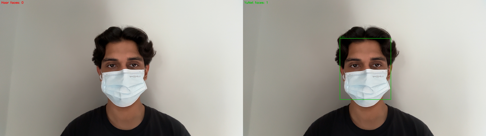

# Face Detection: Webcam Images, Live Video, Masked Faces

## Objectives
1. Detect faces in live images taken from a webcam.
2. Detect faces in a short live video sequence.
3. Detect faces in mask-wearing images.

## Key Concepts

**Face detection vs. face recognition.** Detection answers *where are the faces?*
and returns a bounding box for each one. Recognition answers *whose face is this?*.
This work covers detection only.

**Two families of detectors were compared:**

| | Haar cascade (Viola-Jones) | YuNet (CNN) |
|---|---|---|
| Features | Hand-designed rectangle patterns (e.g. eye region darker than cheeks, nose bridge brighter than eyes) | Learned automatically from data by convolutional layers |
| How it decides | A window must pass a cascade of stages; failing any stage rejects it | One network scores each candidate region; a face is reported if the confidence is above a threshold (0.7 here) |
| Training data | Frontal, unoccluded faces | Large, varied face dataset (poses, scales, occlusion) |
| Output | Box only | Box, confidence score, 5 facial landmarks |

Haar is the classical baseline. YuNet is the main detector.

**Evaluation terms.** *Recall* is the fraction of real faces that were found.
A *false positive* is a box drawn on something that is not a face. Every image and
frame here contains exactly one face. Every detection in the saved images was checked
visually; video was checked on sampled frames.
All captures use the same plain background, lighting and neutral expression, so
pose and mask are the only things that change.

## Objective 1: Webcam Images

Five captures without a mask, one per pose.

| Pose | Haar | YuNet |
|---|---|---|
| Straight, normal distance | Found | Found |
| Head turned | Missed | Found |
| Head turned (other side) | Missed | Found |
| Close to camera | Found | Found |
| Far from camera | Found | Found |
| **Recall** | **3/5** | **5/5** |

No false positives from either detector.

**Interpretation**
- **Scale is handled by both.** Close and far faces were found because both
  detectors search the image at multiple scales, so face size alone is not a problem.
- **Pose breaks Haar.** A turned head changes the light/dark layout Haar's
  rectangle features expect. The frontal cascade was never trained on that layout,
  so it rejects the face. Hand-designed features only cover the appearance they
  were designed for.
- **YuNet generalises.** Its features were learned from faces in many poses, so a
  turned head still matches what it has seen.

## Objective 2: Live Video

Two 10-second webcam recordings (1920x1080), detection with YuNet on every frame.

| Run | Condition | Frames with a face | Detection time |
|---|---|---|---|
| 1 | No mask | 147/147 (100%) | 28.9 ms/frame |
| 2 | Mask | 148/148 (100%) | 25.1 ms/frame |

**Interpretation**
- **Video is a sequence of images.** Each frame is detected independently, so video
  adds no new detection problem. What it adds is two requirements: *consistency*
  (the face should be found in every frame, not flicker in and out) and *speed*
  (detection must keep up with the camera).
- **Consistency:** the face was found in every frame of both runs, so the output is
  stable rather than flickering.
- **Speed:** 25 to 29 ms per frame means about 35 frames per second are possible,
  which is real time. The recordings ran at about 15 FPS overall; the extra time
  went to reading the camera, displaying and saving video, not to detection.
- **Masks do not cost extra time.** A CNN does the same amount of computation for
  every frame, whatever the frame contains.
- **Why the masked video reached 100%.** The face stayed mostly frontal during the
  recording. Objective 3 shows that a masked face which is also turned away is
  harder, so 100% here reflects mostly frontal frames.

## Objective 3: Masked Faces

The same five poses wearing a surgical mask, plus one synthetic control: a standard
OpenCV test image with a mask drawn over the lower face.

| Image | Haar | YuNet (confidence) |
|---|---|---|
| Synthetic control | Missed | Found (0.82) |
| Straight, normal distance | Missed | Found (0.83) |
| Head turned | Missed | Missed (0.62, below 0.7) |
| Head turned (other side) | Missed | Found (0.74) |
| Close to camera | Missed | Found (0.79) |
| Far from camera | Missed | Found (0.93) |
| **Recall** | **0/6** | **5/6** |



**Interpretation**
- **The mask is the cause of Haar's failure.** Haar found the straight, close and
  far faces without a mask, but none of them with a mask. Background, lighting and
  distance were unchanged, so the mask is the only difference. The synthetic control
  shows the same effect on a different face.
- **Why the cascade fails.** The eyes are still visible, so early stages that check
  the eye region can pass. Later stages check nose and mouth contrast, which the
  mask replaces with a flat, bright surface. A cascade rejects a window as soon as
  *any* stage fails, so losing part of the face is enough to lose the detection.
- **Haar is also fooled by face-like texture.** During live capture of the straight
  masked pose, Haar placed a box on the folds of the mask instead of the face: the
  light and dark bands of the folds resemble its rectangle features. When the same
  image was saved and re-analysed, the box disappeared. A result that flips under
  slight compression shows how close to its decision boundary Haar is operating.
- **Why YuNet mostly succeeds.** A CNN combines evidence from the whole region
  instead of requiring every part to match. The eyes, brows, forehead and head
  outline are enough to give a confident score with the lower face hidden.
- **Where YuNet reaches its limit.** Confidence was 0.79 to 0.93 on the frontal
  masked poses but only 0.62 to 0.74 on the two turned, masked poses. The mask hides the lower
  face and the turn hides one side, so only a small part of the face is left as
  evidence. One of the two fell just below the 0.7 threshold and was not reported.
  The face was seen, but not with enough confidence.
- **The threshold is a trade-off.** Lowering it to 0.6 would recover that face, but
  would also let more weak, non-face candidates through as false positives. The
  right value depends on whether missing a face or a false alarm is more costly.

## Summary

| | Haar | YuNet |
|---|---|---|
| Webcam images, no mask | 3/5 | 5/5 |
| Webcam images, mask (with synthetic) | 0/6 | 5/6 |
| Live video (2 runs of 10 s) | not run | 295/295 frames |
| False positives | 1 (mask folds, live capture) | 0 |

## Conclusion
- Both detectors work on the easy case: a frontal, uncovered face. The differences
  appear under *variation*: pose (Objective 1) and occlusion (Objective 3).
- Haar's weakness comes from its design. Hand-crafted features plus an
  all-stages-must-pass cascade make it fast, but brittle whenever the face does not
  look like the frontal faces it was built for, and prone to matching face-like
  texture.
- YuNet's strength comes from learning. Features learned from varied data, combined
  into one confidence score, let it tolerate missing or changed parts of the face
  while running in real time on a laptop CPU.
- YuNet is not unlimited. When pose and occlusion combine, its confidence falls,
  and the final decision depends on the chosen threshold. Detection quality is
  therefore a property of both the model and how its output is thresholded.
- For live video and masked faces, a learned detector is the appropriate choice.
  Haar remains useful as a lightweight baseline for controlled, frontal settings.

## Limitations
- Small test set: one person, one background, 11 images and 2 short videos. The
  results show the behaviour of each method, not a general accuracy benchmark.
- In video, boxes were checked on sampled frames rather than every frame, and the
  masked recording was mostly frontal.
- Both detectors use fixed settings (YuNet confidence threshold 0.7).

## Files
```
src/detectors.py        Haar and YuNet wrappers
src/1_image_capture.py  Objective 1
src/2_video_detect.py   Objective 2
src/3_mask_detect.py    Objective 3
outputs/images/         annotated webcam captures
outputs/video/          annotated video recordings
outputs/mask/           Haar vs YuNet side-by-side comparisons
```
